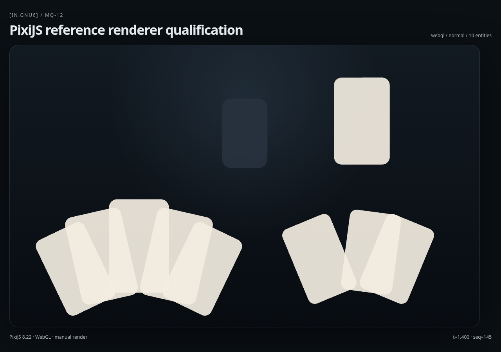

# [in.gnu6]

**Une scène. Plusieurs projections. Une seule autorité sémantique.**
*One scene. Multiple projections. A single semantic authority.*

[in.gnu6] est un moteur **headless de scènes, d’espace et de topologies**. Il organise les identités, les relations, le temps, les contraintes et les transformations d’une scène sans demander à un framework graphique de décider ce qui existe. Les renderers observent et projettent cet état ; les produits conservent leurs propres intentions métier.

Ce dépôt documente un **programme d’ingénierie vérifiable**, pas un produit fini présenté comme universel. Chaque capacité sérieuse doit être liée à une loi, un test de falsification, une observation d’exécution ou un verdict explicitement ouvert.

> **Research status · 2026.10.0-research**
> Moteur sémantique TS : MQ-00→MQ-15 ratifiés pour le mandat documenté. Renderer navigateur de référence : PixiJS 8.22 / WebGL. Renderer Vulkan natif : recherche GPU-05, preuves locales partielles ; **CP03 HYBRID-60 complet non qualifié**. Aucune API publique stable ni publication npm.

## Ce que fait le moteur

Il maintient une scène partageable entre plusieurs consommateurs : relations, hiérarchies, coordonnées spatiales, contraintes, temps déterministe, dynamique, changements topologiques et observations reproductibles.

**Ce qu’il ne fait pas** : inventer le modèle métier d’un Dock, d’une boutique ou d’une interface. Un consommateur peut demander une projection ou transmettre une intention typée ; il ne devient pas propriétaire de l’ontologie de scène.

Deux intégrations consommateurs — Docklab et le harnais SP Joaillerie — servent de pression de falsification pour cette séparation. Les preuves, limites et décisions sont consignées dans [QUESTLOG.md](QUESTLOG.md), [CONTRACT.md](CONTRACT.md) et les [rapports MQ](docs/evidence/).

## Deux couches de rendu, deux statuts de vérité

| Surface | Usage | Preuve actuellement admissible |
|---|---|---|
| **Noyau TypeScript** | Modèle headless : scène, topologie, espace, dynamique, interaction, introspection | Main Quests MQ-00→MQ-15 ratifiés pour leur mandat, avec tests et dossiers de qualification |
| **PixiJS / WebGL** | Projection navigateur de référence, remplaçable | MQ-11 (contrat renderer), MQ-12 (qualification navigateur) |
| **blob.in / Vulkan natif** | Expérimentation de rendu MeshSolid/SDF et cadence Wayland | GPU-05 PACER-07 : deux essais A/B positifs de première frame ; ENDURANCE-01 : **9 370 présentations en 124,994 s, zéro discarded** sur une configuration NVIDIA de référence |
| **CP03 HYBRID-60** | Contrat d’acceptation global | **OPEN** : latence entrée-à-photon indépendante, audit et autres gates non clos |



La preuve **125 secondes / 74,956 FPS de moyenne / p95 13,478 ms / zéro frame écartée** est une observation physique locale via `wp_presentation` sur une surface Wayland attribuée au binaire natif, **pas** une garantie multi-GPU, une certification produit ou une mesure input-to-photon.

**ORACLE-05 (preuve live)** : Rust et le projecteur sémantique TypeScript in.gnu6 échangent 40 événements Wayland réels sur un socket Unix privé, avec correspondance de séquence exacte et 1 497 frames présentées sans discard en 20 s. **Les 20 appuis se projettent sur stage, jamais cavity-control : la calibration visuelle reste non qualifiée.** CP03 OPEN. [Rapport ORACLE-05](experiments/blobin-next-01/CP02-VULKAN/GPU-05-ORACLE-05-STATUS.md).

ORACLE-04 observe 10 cycles optiques logiciels corrélés sur 35 s, sans excès de gap >33,4 ms dans cet essai ; l'ancienne interruption de 413 ms reste inexpliquée. [Rapport ORACLE-04](experiments/blobin-next-01/CP02-VULKAN/GPU-05-ORACLE-04-STATUS.md).

ORACLE-03 prépare la **projection sémantique typée** des coordonnées Wayland vers `InteractionProjector` (10 lois TypeScript PASS, un test Rust PASS). Le premier essai a été refusé par le garde GNU6 (code 75). Un **nouvel essai protégé de 24 s** a ensuite présenté 1 769 frames, zéro discarded, mais révèle **une interruption de 413,544 ms (gate de régularité RED)**. Aucun clic réel n'a été observé ; aucune calibration photodiode ni acceptation CP03. [ORACLE-03](experiments/blobin-next-01/CP02-VULKAN/GPU-05-ORACLE-03-STATUS.md) · [Preuve physique & anomalie](experiments/blobin-next-01/CP02-VULKAN/GPU-05-ORACLE-03-PHYSICAL-01-STATUS.md).

ORACLE-02 introduit un **témoin optique expérimental activé par entrée Wayland**, côté renderer : 15 nouveaux tests ciblés PASS et un smoke Vulkan 10 s sans frame écartée. **Aucun clic réel n'a été observé pendant ce run ; l'entrée-à-photon reste non qualifiée.** [Rapport ORACLE-02](experiments/blobin-next-01/CP02-VULKAN/GPU-05-ORACLE-02-STATUS.md).

L'analyseur indépendant entrée-à-photon est en préparation : **23 tests de contrat/manifestes PASS**, capture matérielle **NOT RUN**. [ORACLE-01](experiments/blobin-next-01/CP02-VULKAN/GPU-05-ORACLE-01-STATUS.md).

Voir [PACER-07](experiments/blobin-next-01/CP02-VULKAN/GPU-05-PACER-07-STATUS.md) et [ENDURANCE-01](experiments/blobin-next-01/CP02-VULKAN/GPU-05-ENDURANCE-01-STATUS.md). Les traces brutes restent dans le registre local de preuves ; les rapports distinguent les artefacts effectivement reproductibles des portes d’acceptation encore ouvertes.

## Reproduire sans amplifier l’autorité

Prérequis du noyau : **Node.js ≥24**, npm et un environnement compatible avec les dépendances verrouillées.

```bash
npm ci
npm run typecheck
npm test
npm run test:browser
```

Ces commandes couvrent des vérifications différentes : tests de lois et de modèle, qualification TypeScript, et parcours navigateur nécessitant Playwright. Elles ne constituent **pas** une qualification NVIDIA, AMD, Intel ou de présentation Wayland.

Pour les expérimentations GPU sur la station de référence, l’exécution lourde est encadrée : **`gnu6-lab-run --check` puis `gnu6-lab-run --exclusive`**, avec les limites cgroup et les refus documentés. **Ne lancez pas un benchmark Vulkan/CUDA directement en contournant ce contrôle.** Les rapports GPU-05 fournissent les identifiants de code, de binaire et des preuves ; ne répétez pas un gate fermé sans hypothèse nouvelle.

## Lire le projet

- [Contrat de scène et d’autorité](CONTRACT.md) : frontières entre moteur, renderer et consommateur.
- [Questlog](QUESTLOG.md) : mandats, résultats négatifs, décisions et prochaines falsifications.
- [Provenance du noyau initial](docs/provenance/seed-b07be20.md) : ce qui est issu du donneur et ce qui est autonome.
- [Méthode de versionnement](docs/release/VERSIONING.md) : versions calendaires motivées et checkpoints identifiés, sans microversions fictives.
- [Qualification avant publication](docs/public/PUBLICATION-READINESS.md) : secrets, licences, preuves et limites de distribution.

## Public et open source : frontières actuelles

Le dépôt GitHub **gnu6dotlive/in.gnu6 est PUBLIC** (visibilité confirmée le 2026-10-10) et, depuis le 2026-10-30, **sous licence MIT** (`LICENSE`), par décision de l’opérateur. Le code peut donc être copié, modifié et redistribué selon ces termes. Le paquet npm reste **`private: true`** : aucune publication npm, aucun contrat de distribution et aucune stabilité d’API publique ne sont promis.

Les corrections éditoriales, les questions reproductibles et les contre-exemples techniques sont bienvenus selon les règles de contribution qui seront publiées avec l’ouverture du dépôt.

---

### English · technical summary

**[in.gnu6]** is a headless scene, spatial and topology engine. Its semantic core owns scene identity, relations, spatial constraints, deterministic time and topology; renderers project the scene and products retain their own business intent. TypeScript is the reference semantic implementation, PixiJS 8.22 / WebGL is the qualified browser projection, and the Vulkan / blob.in path is an experimental native renderer.

**What is proven:** the scoped MQ-00–MQ-15 mandate has documented engineering evidence; a local NVIDIA/Wayland endurance run produced 9,370 compositor-presented frames over 124.994 seconds without discarded feedbacks. **What is not proven:** full CP03 acceptance, independently calibrated input-to-photon latency, cross-vendor portability, production-grade public APIs, or package distribution rights.

See the [version policy](docs/release/VERSIONING.md), [publication checklist](docs/public/PUBLICATION-READINESS.md) and [GPU-05 evidence](experiments/blobin-next-01/CP02-VULKAN/GPU-05-ENDURANCE-01-STATUS.md).
